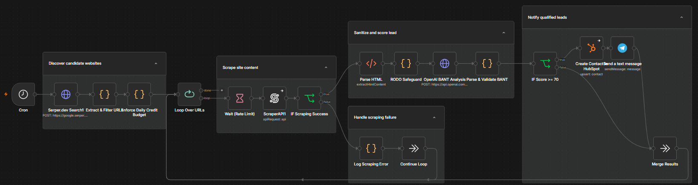
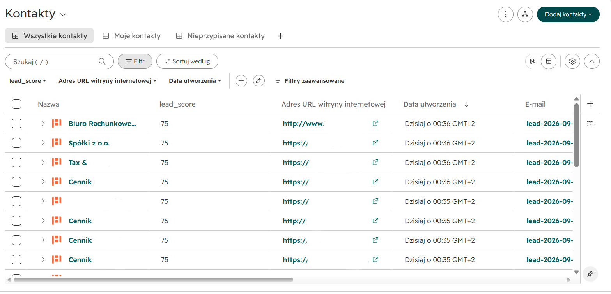
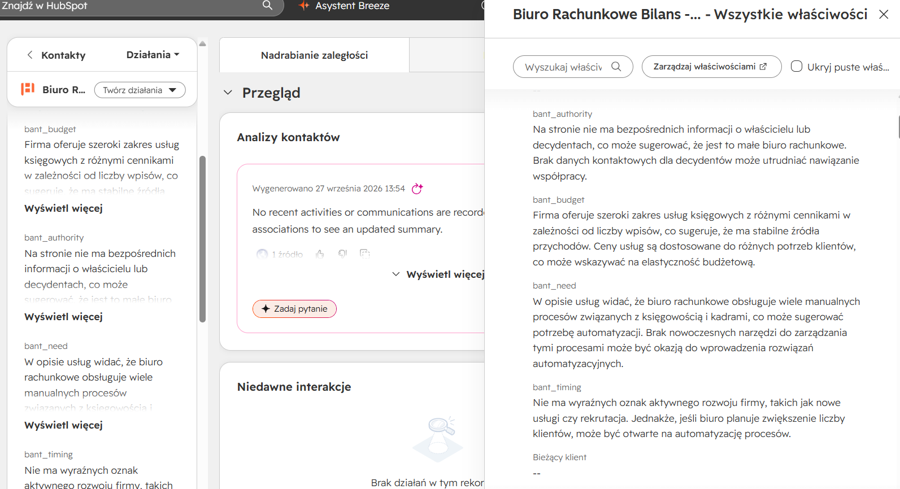
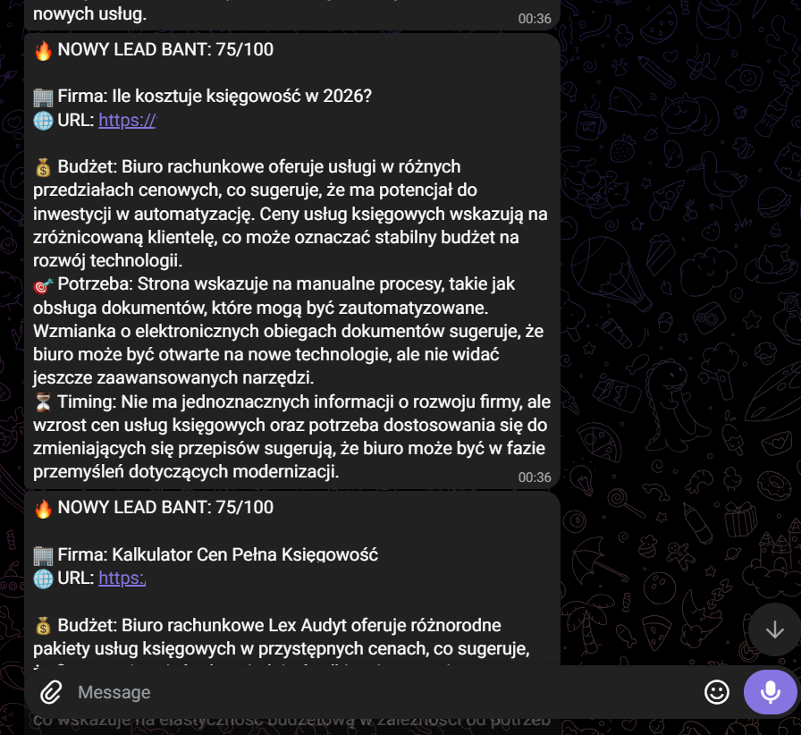

# 🎯 Autonomous BANT Lead Qualification & CRM Ingestion Engine

[](LICENSE)
[](https://n8n.io/)
[](https://openai.com/)
[](https://www.hubspot.com/)
[](https://www.docker.com/)
[](https://telegram.org/)

An event-driven, production-grade automation pipeline built with **n8n** that acts as an autonomous **AI SDR (Sales Development Representative)**. The engine orchestrates target domain discovery via Serper, web scraping and HTML sanitization via ScraperAPI, deterministic **BANT qualification** using structured OpenAI prompts, and automated synchronization into **HubSpot CRM** coupled with instant **Telegram sales alerts**.

---

## ⚡ Key Highlights & Business Capabilities

* **Autonomous Discovery & Ingestion:** Event-driven execution (Cron / Webhook) querying Google search index via Serper API, streaming targeted company domains into isolated processing queues.
* **Resilient HTML Scraping & Sanitization:** Ingests live company web assets using ScraperAPI proxies, stripping tracking scripts, cookie banners, and boilerplates to optimize LLM context token usage.
* **Deterministic BANT Evaluation:** Assesses target companies across structured dimensions:
  * **Budget:** Analyzes pricing tiers, enterprise calculators, and service complexity.
  * **Authority:** Verifies executive leadership presence and direct corporate decision pathways.
  * **Need:** Identifies operational bottlenecks receptive to AI & workflow automation.
  * **Timing:** Detects expansion momentum, hiring spikes, or regulatory shifts.
* **Compliance & PII Redaction:** Contacts pass through regex-based sanitization and deterministic hashing (`lead-YYYY-MM-DD-[hash]@placeholder.com`), isolating verified tax IDs (`NIP`) while safeguarding data hygiene.
* **Conditional CRM Quality Gate:** Strict routing logic (`lead_score >= 70`) filters out low-intent leads, preventing CRM database pollution and outbound sales fatigue.

---

## 🏗️ System Architecture & Data Flow

```text
[Cron / Webhook Trigger]
          │
          ▼
    [Serper API] ────────(Target Domain Discovery)
          │
          ▼
   [ScraperAPI] ─────────(Raw HTML Ingestion & Sanitization)
          │
          ▼
   [Regex / Code] ───────(NIP / Tax ID Extraction & PII Redaction)
          │
          ▼
  [OpenAI Engine] ───────(Deterministic BANT Scoring & Synthesis)
          │
          ▼
   [Decision Gate] ──────(lead_score >= 70?)
         ├── YES ────────► [HubSpot CRM Integration] & [Telegram Alert Bot]
         └── NO  ────────► [Drop / Archive Unqualified Lead]

```

* **Orchestration:** n8n self-hosted within a Docker environment with persistent volume storage.
* **LLM Engine:** OpenAI `gpt-4o-mini` with temperature configured for deterministic JSON schema outputs.
* **Target CRM:** HubSpot CRM API v3 with pre-mapped custom properties (`bant_score`, `bant_summary`, `website`).
* **Dispatch Layer:** Telegram Bot API delivering real-time actionable notifications to sales teams.

---

## 📸 Production Run Previews

### 1. Workflow Architecture & Canvas

Full end-to-end orchestration in **n8n** showing discovery, conditional filtering, regex data sanitization, LLM grading, and conditional CRM routing:



### 2. High-Precision CRM Ingestion (HubSpot)

Qualified companies are mapped and synchronized to HubSpot CRM with scores, domain references, and automated pipeline assignments:



### 3. Deep Qualitative Qualification

Sales representatives receive direct qualifying context inside custom HubSpot properties, removing manual discovery overhead:



### 4. Immediate Outbound Alerting (Telegram)

High-intent leads immediately trigger actionable mobile alerts with direct links and executive summaries:



---

## 📂 Repository Structure

```text
├── .env.example                     # Environment template for API keys & tokens
├── .gitignore                       # Isolation rules for secrets and local state
├── docker-compose.yml               # Container deployment spec for n8n service
│
├── assets/                          # Production execution screenshots
│   ├── hubspot_leads_table.png
│   ├── hubspot_record_bant_view.png
│   ├── n8n_workflow_canvas.png
│   └── telegram_alert.png
│
├── docs/                            # Deployment specifications
│   ├── hubspot_custom_properties.md # Required HubSpot custom property schema
│   └── telegram_payload_example.json# Sample webhook event payload
│
└── workflow/
    └── bant_lead_engine.json        # Exported production n8n workflow

```

---

## 🚀 Quickstart & Deployment

### 1. Environment Setup

Clone the repository and copy the environment template:

```bash
git clone https://github.com/JohnStononloan/bant-lead-qualification-engine.git
cd bant-lead-qualification-engine
cp .env.example .env

```

Populate the required credentials in `.env`:

```bash
OPENAI_API_KEY=your_openai_api_key
SERPER_API_KEY=your_serper_api_key
SCRAPERAPI_KEY=your_scraperapi_key
HUBSPOT_ACCESS_TOKEN=your_hubspot_token
TELEGRAM_BOT_TOKEN=your_telegram_bot_token
TELEGRAM_CHAT_ID=your_telegram_chat_id

```

### 2. Configure HubSpot Properties

Ensure required custom properties are created in HubSpot prior to workflow import, as specified in `docs/hubspot_custom_properties.md`.

### 3. Launch & Import Workflow

Start the n8n containerized service:

```bash
docker compose up -d

```

1. Open your browser and navigate to `http://localhost:5678`.
2. Select **Workflows > Import from File** and upload `workflow/bant_lead_engine.json`.
3. Bind your credentials to the respective nodes and activate the workflow.

---

## 🔒 Security & Data Hygiene

* **Zero Hardcoded Secrets:** Credentials, access tokens, and API keys are strictly injected via `.env` and secured n8n credential managers.
* **PII Redaction Layer:** Personal identity elements are stripped or hashed before evaluation to preserve privacy standards and prevent CRM contamination.
* **Cost Cap Guardrails:** Uses `gpt-4o-mini` with token constraints and validation quotas, preventing runaway billing on unvalidated web domains.


